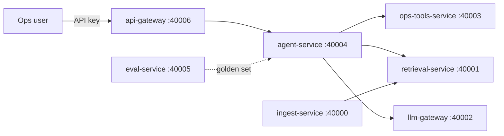

# AmazonSCMGenAI


A GenAI exception-triage platform for retail fulfilment operations. When a shipment goes wrong (delayed, silent in transit, failed delivery, damaged), an agent retrieves the relevant SOP passages, proposes the corrective actions, and explains them with citations. Nothing executes without human approval, and approval rights are enforced in code.

This is a portfolio project. The data is synthetic, the LLM is a deterministic stub, and the AWS deployment is not built yet (see [Status and limits](#status-and-limits)). What it demonstrates is the architecture, the controls around the model, and a way to measure quality instead of asserting it.

## Architecture



| Service | Port | Responsibility |
|---|---|---|
| api-gateway | 40006 | Only public entry point. API key becomes identity and role; rate limit; request ids |
| agent-service | 40004 | Triage pipeline: facts, retrieval, planned actions, cited explanation, approval flow |
| ops-tools-service | 40003 | Shipment facts, SLA band computation, action lifecycle with policy and approval rules |
| retrieval-service | 40001 | BM25 search over SOP chunks, returns citable passages |
| ingest-service | 40000 | Chunks SOP markdown (heading-aware, with overlap) and indexes it |
| llm-gateway | 40002 | Single model interface: PII redaction, injection check, cache, token and cost metering |
| eval-service | 40005 | Runs a golden set against the agent and applies pass/fail gates |

Only the gateway is published, bound to 127.0.0.1. The other services live on the compose network, which a runtime check verifies (see CI).

### Request flow

1. The gateway authenticates the API key. Identity and role come from the key, never from the request body.
2. agent-service reads the shipment from ops-tools-service, which computes the exception type and SLA band. The model never does date arithmetic.
3. A situation-specific query goes to retrieval-service, which returns SOP passages.
4. A rule-based planner proposes the actions. ops-tools-service enforces the SOP preconditions and approval levels and refuses forbidden actions (for example, no refund during a lost-shipment investigation hold).
5. llm-gateway produces the explanation. Every citation must refer to a chunk that was actually retrieved, otherwise the text is discarded and a deterministic summary is used.
6. A human approves through the gateway. The approver must differ from the proposer, the role must meet the required level, and an action executes at most once.

## Design decisions

- [ADR-001](docs/adr/001-rag-over-finetuning.md): RAG with tools instead of fine-tuning, because SOPs change weekly and answers must cite sources.
- [ADR-002](docs/adr/002-deterministic-planner-llm-explains.md): a deterministic planner chooses actions and the LLM only explains, because a wrong write action costs money and trust.
- [ADR-003](docs/adr/003-gateway-derived-identity.md): identity and approval role are derived at the gateway, which closed a role-escalation hole in the first design.

[docs/ARCHITECTURE.md](docs/ARCHITECTURE.md) is the original design sketch. ADR-002 records where the implementation deliberately diverged from it.

## Results

Agent eval: 11 scenarios from [data/golden/agent.jsonl](data/golden/agent.jsonl), run against the container stack on a development machine. The full report is in [docs/eval/latest.json](docs/eval/latest.json).

| Metric | Value |
|---|---|
| Cases passed | 11 / 11 |
| Action precision / recall | 1.0 / 1.0 |
| Forbidden-action violations | 0 |
| Approval role accuracy | 1.0 |
| Governing SOP section retrieved | 1.0 |
| Context precision (relevant passages / retrieved) | 0.713 |
| Triage latency p50 / p95 | 12.7 ms / 24.1 ms |
| Cost per triage | about 0.00016 USD (placeholder pricing) |

Retrieval (BM25 over 21 chunks from 6 SOPs): MRR 0.77 to 0.88 on the 12-question dev set after tuning. A held-out set of 8 questions, written before tuning, scores 1.00. Both sets are small, and the check runs in CI.

## Engineering notes

These are things that were measured, not assumed.

- **Shared HTTP clients.** Building a new httpx client per call cost about 220 ms (TLS context setup) on the development machine, against 2 to 8 ms for a shared client. Median triage time fell from 14.1 s to 34 ms. A regression test guards it.
- **localhost vs 127.0.0.1.** On Windows, `localhost` took about 2.4 s per call and `127.0.0.1` about 0.26 s, so all defaults use `127.0.0.1`.
- **A bug only the container run could find.** A default file path computed from the repo layout crashed two services inside a container. The compose smoke test now catches that class of bug.
- **Eval cost depended on cache state.** Cached LLM calls cost nothing, so the metric changed with whatever ran before it. The eval now resets the cache and the ops-tools data on every run.

## Run it

Needs Docker and Python 3.12.

```bash
cp .env.example .env        # local development keys only
docker compose -f docker-compose.yml -f docker-compose.test.yml up -d --build --wait
docker compose -f docker-compose.yml -f docker-compose.test.yml exec -T ingest-service \
  python -c "import urllib.request as u; u.urlopen(u.Request('http://127.0.0.1:40000/v1/ingest', method='POST'), timeout=30)"
python scripts/run_eval.py
```

On Windows, `scripts\compose_up.ps1` does the same, and `scripts\compose_down.ps1` stops everything. The test overlay (`docker-compose.test.yml`) turns on reset hooks and publishes the eval service on loopback; never use it for a real deployment.

Try a triage (SHP-1007 has been silent for over 96 hours):

```bash
curl -s -X POST http://127.0.0.1:40006/v1/triage \
  -H "X-API-Key: dev-l1-key-01" -H "Content-Type: application/json" \
  -d '{"shipment_id":"SHP-1007"}'
```

Unit tests run per service: `cd services/<name>`, `pip install -r requirements.txt pytest httpx`, `pytest -q`. The offline retrieval check is `python scripts/check_retrieval.py`.

## Status and limits

- The LLM is a deterministic stub. `BedrockProvider` (Converse API) is implemented but has not been run against live AWS.
- `grounded_rate` is currently a plumbing check: the stub cites every source it is given. It becomes meaningful with a real model.
- The golden sets are small and written by the author, and all data is synthetic.
- Rate limiting is in memory per replica, and the API keys are static.
- Dependencies are not pinned.

## Roadmap

- AWS phase: Bedrock Converse, OpenSearch-backed retrieval, ECS, Terraform.
- Embedding retrieval compared against BM25 on the same golden sets.
- A model-graded faithfulness eval, so the grounding metric measures something real.
- Pinned dependencies and a shared rate-limit store.