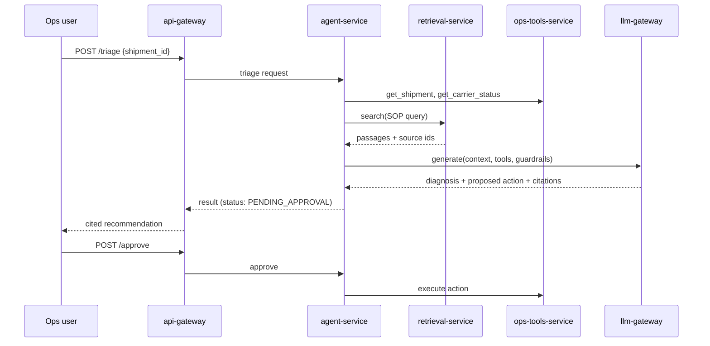

# AmazonSCMGenAI - Architecture

> **Status:** original design sketch. The implementation diverges in one deliberate way: the LLM does not receive tools or choose actions; a rule-based planner does (see [ADR-002](adr/002-deterministic-planner-llm-explains.md)). The sequence diagram below predates that decision.

## 1. Problem
Fulfilment operations teams handle thousands of shipment exceptions a day (delayed, stuck in transit,
carrier SLA breach, address failure). Each needs a diagnosis, the right SOP, and an action. Today this is
manual lookups across runbooks and tools. This platform automates triage with a grounded, auditable GenAI agent.

## 2. Goals and non-goals
Goals
- Every recommendation cites the SOP passage it came from (groundedness).
- The agent takes no write action without human approval.
- The model provider is swappable (local stub <-> Amazon Bedrock) with no change to other services.
- Quality is measured in CI with a golden set, not assumed.
- Cost and latency per request are visible.

Non-goals: real Amazon data, model fine-tuning, a production UI.

## 3. Services
| Port  | Service            | Responsibility |
|-------|--------------------|----------------|
| 40000 | ingest-service     | Chunk and embed SOPs, carrier SLAs, runbooks |
| 40001 | retrieval-service  | Top-k semantic search with source metadata |
| 40002 | llm-gateway        | Single LLM interface, guardrails, PII redaction, metering, cache |
| 40003 | ops-tools-service  | Mock order, shipment, inventory, carrier APIs (agent tools) |
| 40004 | agent-service      | Tool-using triage agent with approval step |
| 40005 | eval-service       | Golden-set scoring: groundedness, tool-call accuracy |
| 40006 | api-gateway        | Public entry point and aggregator |

## 4. Request flow (exception triage)

## 5. Local vs AWS mapping
| Concern        | Local (phase 1)        | AWS (phase 3) |
|----------------|------------------------|---------------|
| LLM            | Deterministic stub     | Bedrock Converse API |
| Embeddings     | TF-IDF / hashing       | Bedrock Titan embeddings |
| Vector store   | In-memory / FAISS      | OpenSearch Serverless (Bedrock Knowledge Bases) |
| Compute        | Docker Compose         | ECS Fargate (+ Lambda for ingest) |
| Entry point    | api-gateway container  | API Gateway + ALB |
| State          | SQLite                 | DynamoDB |
| Guardrails     | Regex/rules            | Bedrock Guardrails + rules |
| Observability  | Prometheus             | CloudWatch + Prometheus |
| IaC            | -                      | Terraform |

## 6. Cross-cutting design rules
- Provider abstraction lives only in llm-gateway; no other service imports a model SDK.
- Every service exposes /health and /metrics (Prometheus).
- Every LLM call records tokens in/out, latency, cost estimate, and cache hit.
- Failure mode: if retrieval is down, the agent returns "insufficient context" and never answers ungrounded.
- Secrets via environment variables locally, Secrets Manager on AWS.

## 7. Risks
- Hallucinated actions: mitigated by tool allow-list, schema-validated tool calls, human approval.
- Prompt injection via SOP text: mitigated by delimiting retrieved text and output validation.
- Cost growth: mitigated by caching, a token budget per request, a model-tier choice (see ADR-002 later).
